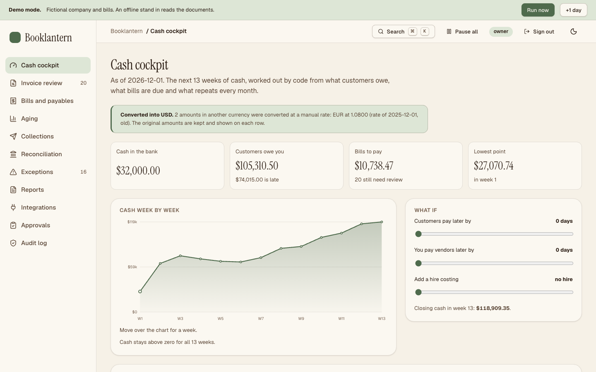
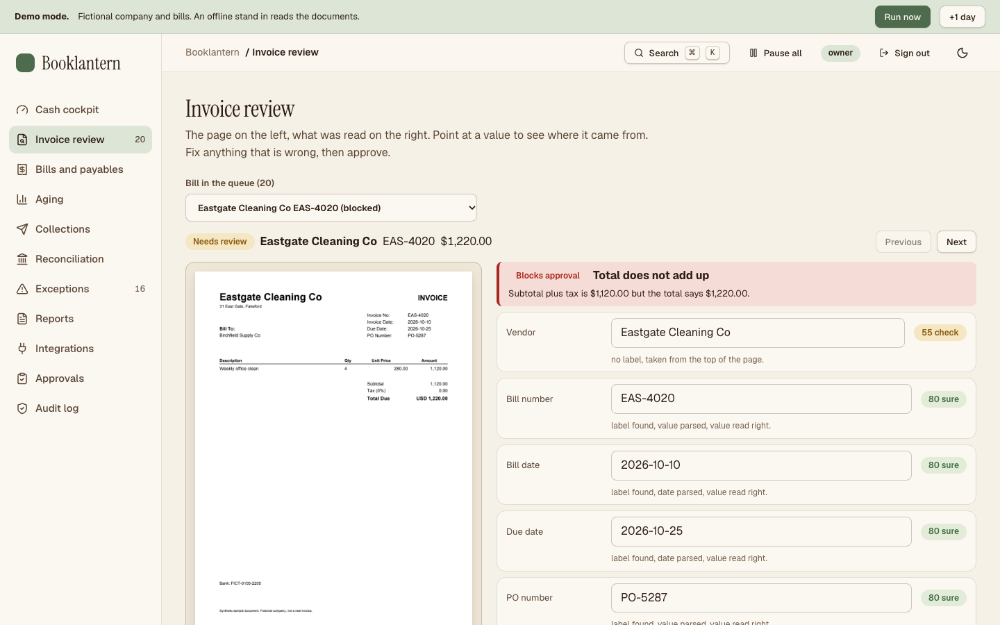
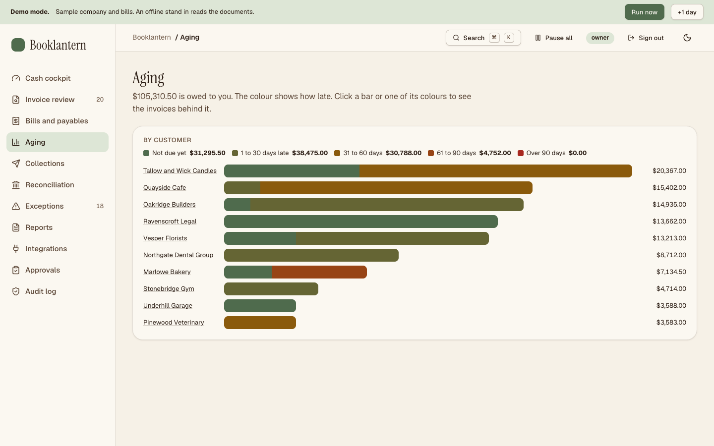

# Booklantern

A finance back office for one small business, set up by an implementer. It reads vendor bills, checks them with code, chases late customers, matches the bank statement and shows the next 13 weeks of cash. A person approves everything that matters. It never moves money and gives no tax or accounting advice.

## What it does

- Reads a bill and shows the page next to the fields, with a box on the page for each value and a confidence word for each field.
- Checks every bill with code: totals, tax, line sums, duplicates, a bill far above the usual, changed bank details, missing purchase order, future date, wrong currency, wrong company.
- Chases late invoices with a reminder ladder and stop rules (a payment, a dispute, a promise, an opt out or a bankruptcy flag stops it). Draft mode saves reminders instead of sending them. Every reminder carries your name, your postal address and a way to stop them; a person records an opt out when a customer asks.
- Matches a CSV bank statement to invoices and bills and finds split payments.
- Forecasts 13 weeks of cash by code, with a slider for "what if customers pay later".
- Handles bills and invoices in other currencies with exchange rates a person types in by date. Every converted number shows its original amount, the rate and the date, and an item with no rate is left out and flagged, never guessed.
- Builds a month end PDF.

| Invoice review | Aging |
|---|---|
|  |  |

## Try it

Follow [docs/01-QUICK-DEMO.md](docs/01-QUICK-DEMO.md). Everything in the demo is fictional and nothing leaves your computer.

## Use it for a client

Start at [docs/00-START-HERE.md](docs/00-START-HERE.md). The guides run from 00 to 15, with reference pages for the design, capabilities, tools and alternatives, facts and sources, and the extraction evaluation.

## What was measured

Numbers come from `data/counts.json`.

- <!--n:tests.passed-->323<!--/n--> Python tests passed and <!--n:tests.skipped-->1<!--/n--> was skipped (the Postgres cycle). Line coverage of the `booklantern` package: <!--n:tests.coverage_percent-->92.3<!--/n--> percent.
- <!--n:e2e.tests-->41<!--/n--> browser tests in Chrome: the whole demo path, accessibility scans of all <!--n:pages-->11<!--/n--> pages in light and dark with 0 serious or critical problems, keyboard use, reduced motion, 5,000 bank lines, no layout shift, no console errors, and pictures of 12 named states (including a button mid action, a toast with undo, an empty list and a failed load) at desktop and phone width.
- Property tests: the forecast, money rounding and currency conversion, and the reminder stop rules on 400 random worlds of 90 days.
- The seed check (`python tools/score_seed.py`): 25 of 25 planted document problems found with 0 extra flags, and 183 of 184 bank lines matched as the answer key says. The same author wrote the data and the checks, so these are not independent scores.
- **The reader is weak on new layouts.** The offline reader is rules, not a language model. On the documents it was built against it got every field right. On our own earlier test (<!--n:heldout_documents-->24<!--/n--> documents) it got 37.8 percent. On 105 bills written by other people who never saw the code, the first run of the current reader got 75.2 percent of fields right on the second set (5 of 48 documents with every field right). See [docs/EXTRACTION-EVAL.md](docs/EXTRACTION-EVAL.md).

## Honest limits

The accounting, payment and mailbox connections were tested only against stand in servers we wrote and never against the real services. The model path (a language model reads bills and words text, code checks it) was run only against a local fake server, never with a real key. Contract tests (6) check the adapters against saved excerpts of public docs, but QuickBooks bill and invoice paths could not be fetched and stay unverified. The GitHub CI workflow builds the Docker images and starts the stack, but the Vercel, Railway and Hetzner guides were never deployed to a real host. Read [docs/14-LIMITS-AND-HONEST-NOTES.md](docs/14-LIMITS-AND-HONEST-NOTES.md) before you promise a client anything.

## Safe by default

Draft mode is the default. Nothing is posted or sent until a person sets live mode and, for accounting, the write switch. It has no bank login and cannot start a payment. See [SECURITY.md](SECURITY.md).

## Licence

See `LICENSE`.
