# Capabilities

Every screen, what it does, how to use it. Screenshots were taken from the demo data (a sample company) at 1440 by 900. Phone versions are in `docs/screenshots/` too, <!--n:screenshots-->47<!--/n--> pictures in all.

## Cash cockpit

Cash now, what customers owe, bills to pay and the lowest point in the next 13 weeks. Drag the sliders (customers pay later, you pay vendors later, add a hire) and the chart redraws. A dashed line is the plan without your changes. A plain words box explains the forecast.

## Invoice review
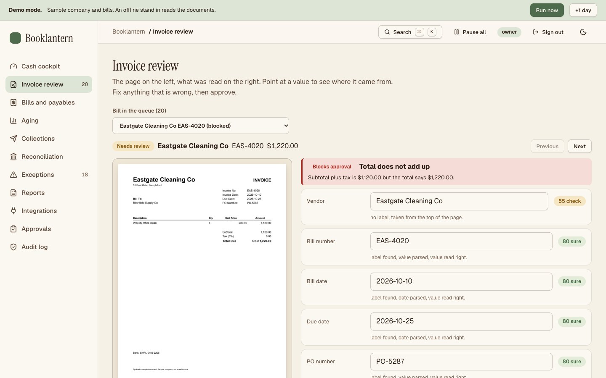
The bill page on the left, the fields on the right. Click a field and its box lights up on the page. Each field has a confidence word and the reasons. Edit any field and save, and the checks run again. A blocking finding needs a written reason before Approve. After approval, Post as a draft makes a draft entry for the accounting system, or tells you why nothing was posted.

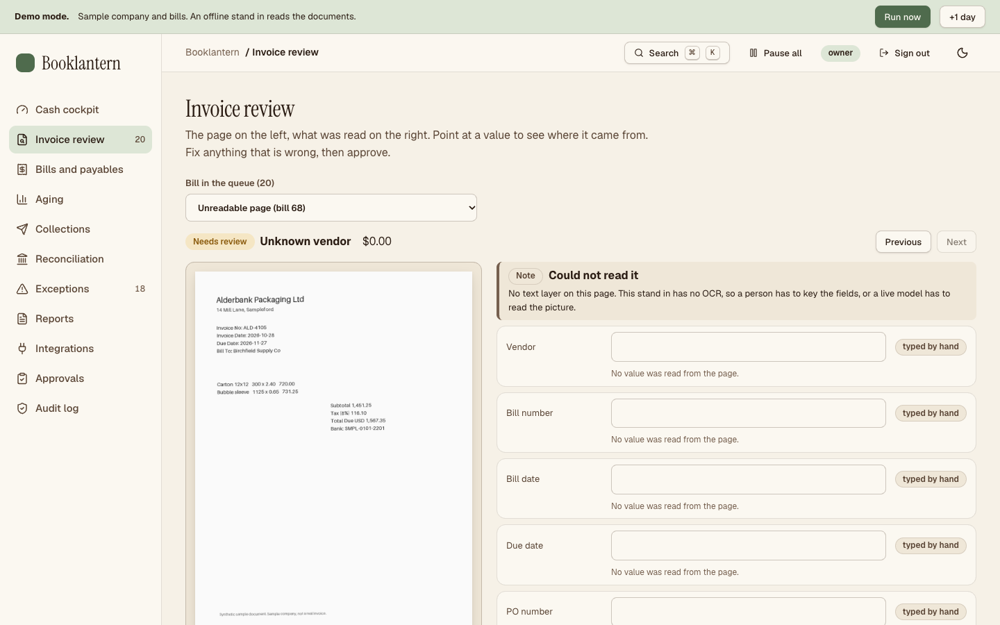
A scan has no text layer, so the offline reader says so and you key the fields.

## Bills and payables
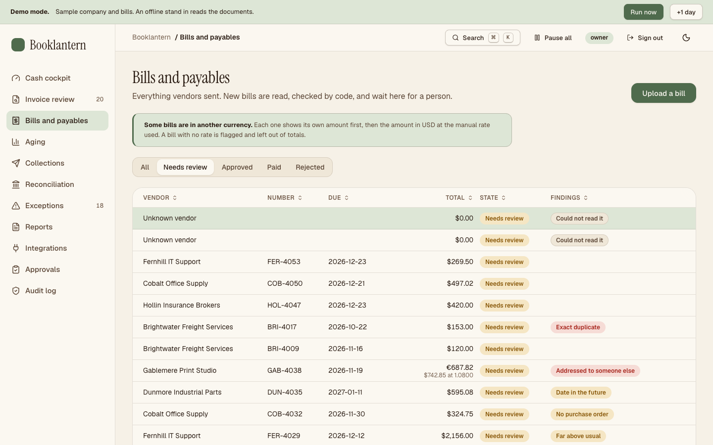
Every bill with its findings. Filter by state. Upload a PDF or picture here.

## Aging
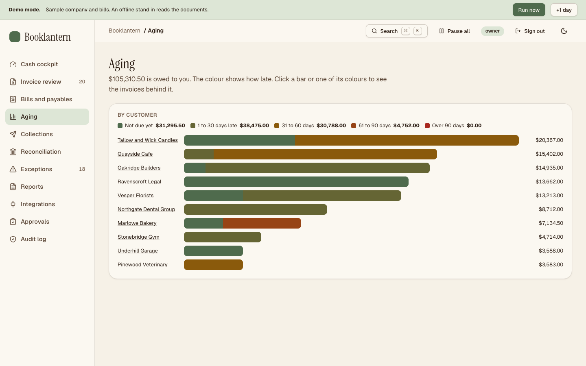
Who owes you, by how late. Click a bar or one colour of it to see the invoices behind it.

## Collections
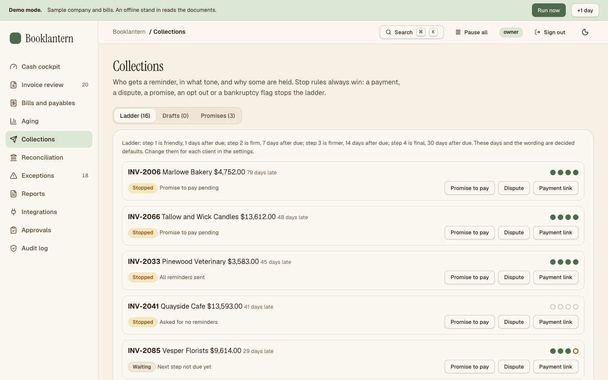
The ladder for every open invoice: dots show reminders sent, and the badge says whether the next one is due, waiting or stopped, and why. Record a promise to pay, mark a dispute, make a payment link. Drafts waits for your approval. Promises lists what customers said.

## Reconciliation
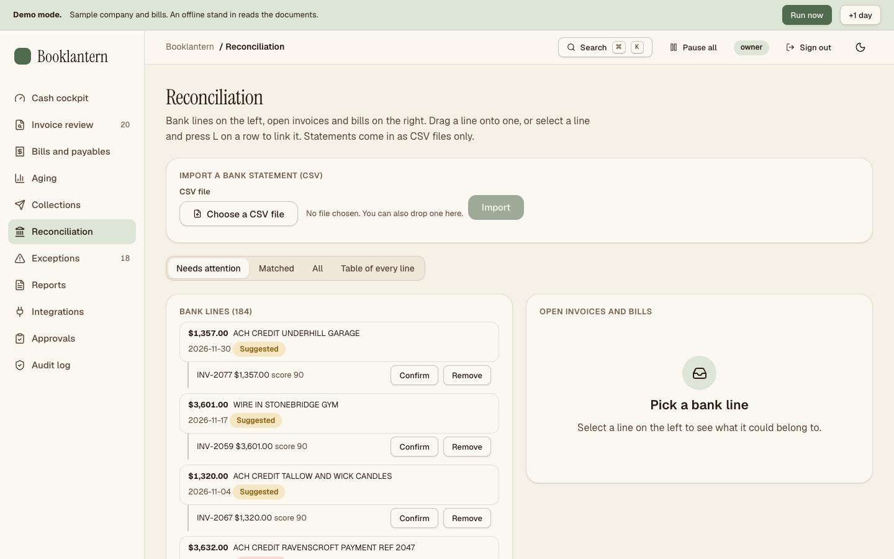
Import a CSV statement. Bank lines on the left, open invoices and bills on the right. Drag a line onto an item, or select a line and press Link. Confirm or remove suggested matches. The Table of every line view stays fast with thousands of lines.

## Exceptions
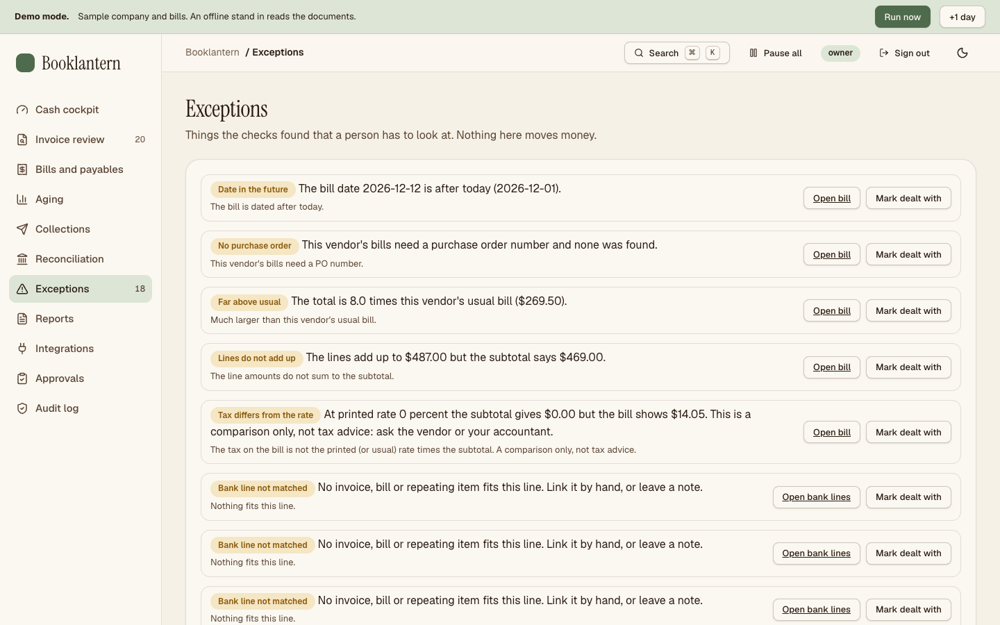
Everything the checks want a person to look at, with a link to the bill or the bank lines.

## Reports
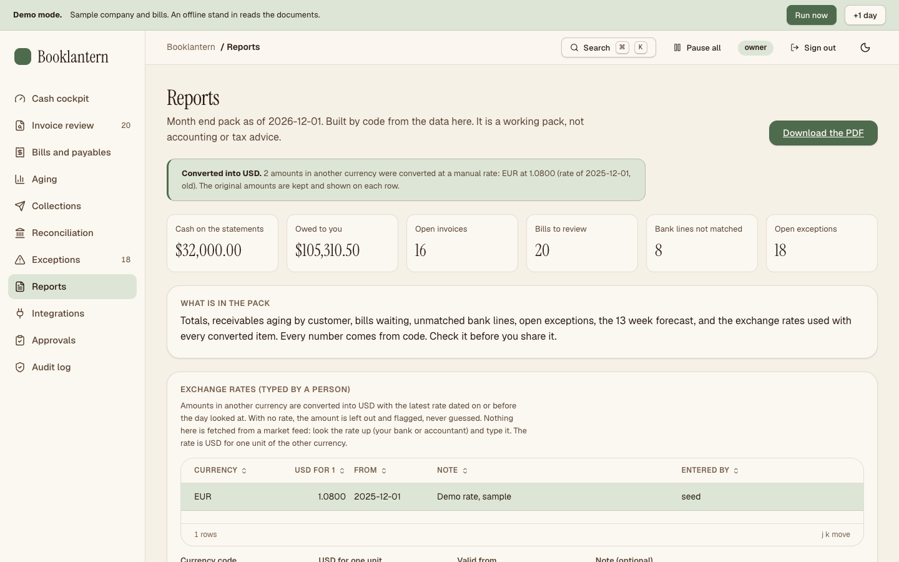
Month end numbers and a PDF built by code, and the table of manual exchange rates (add a rate with its date; a note above the totals says when any number was converted, and the PDF ends with the rates used).

## Integrations
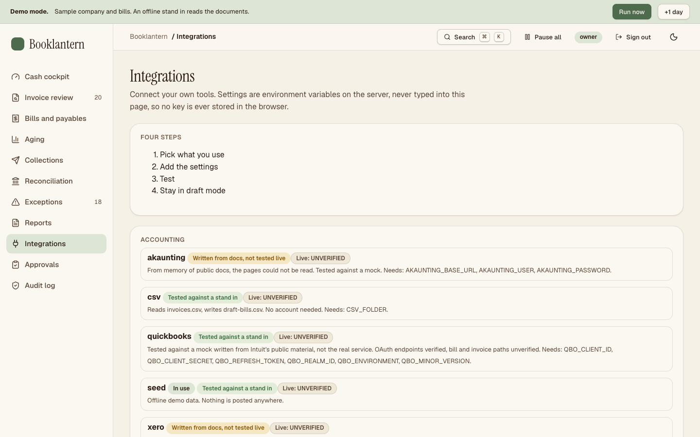
Which adapters exist, which one is in use, what each needs, and a Test button. Settings are server variables, never typed into the page.

## Approvals
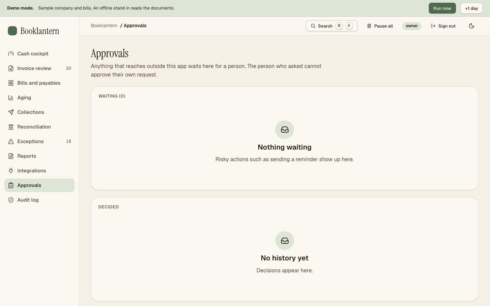
Risky actions wait here. The person who asked cannot approve.

## Audit log
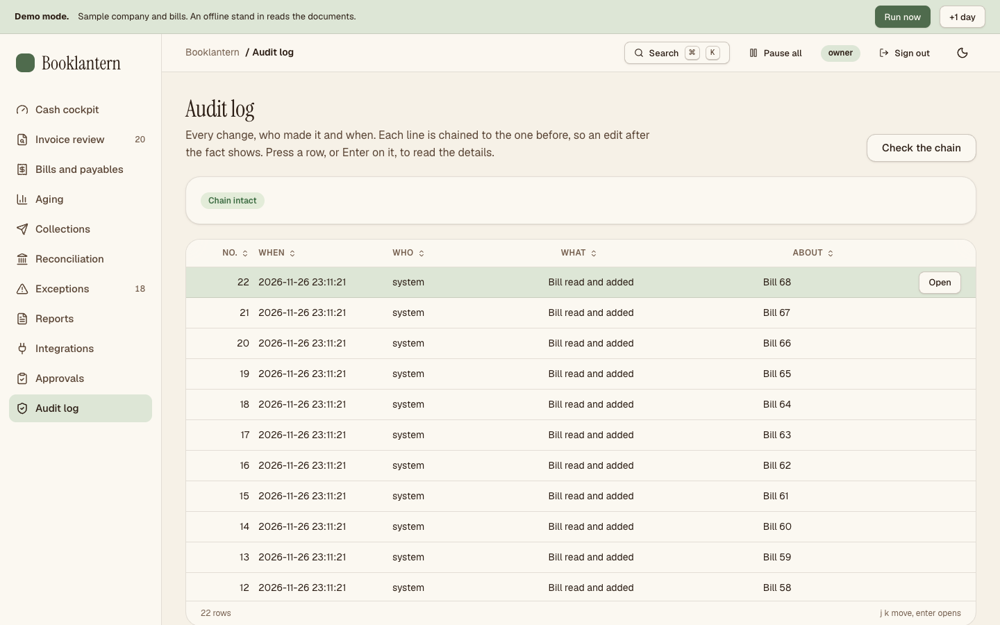
Every change, chained, in plain words. Press a row (or Enter on it) to read its details. Press Check the chain.

## States

Every screen handles waiting, answering, empty and failing. Pictures at desktop and phone width are in `docs/screenshots/`.

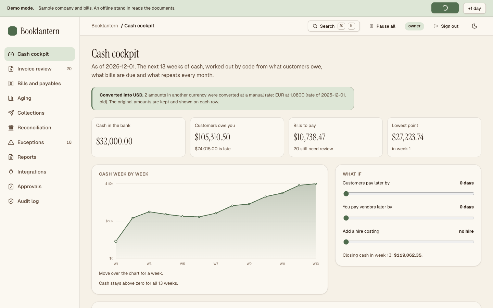
A button shows a spinner while its action runs.

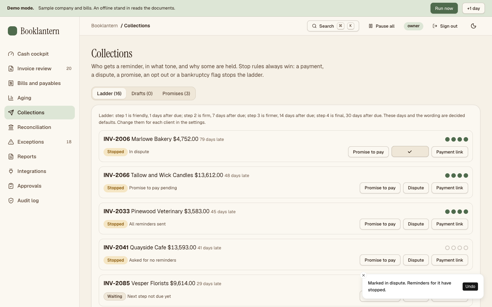
Marking a dispute shows a message with Undo for a few seconds.

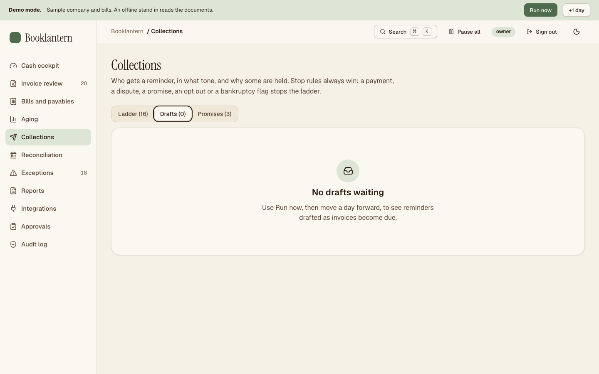
An empty list says why and what to do next.

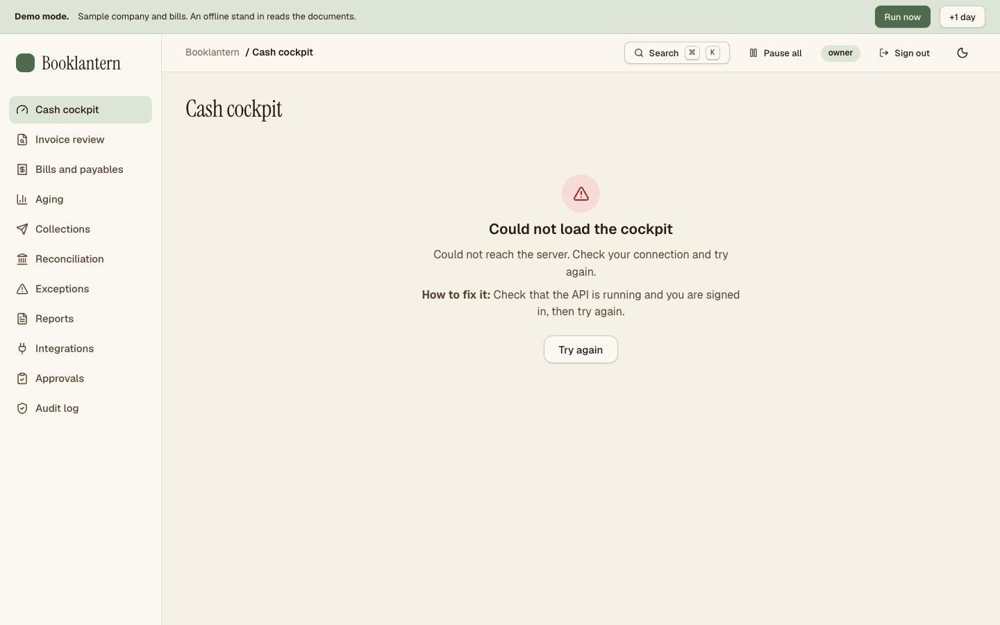
If the server cannot be reached the page says so, tells you how to fix it and offers Try again.

## Also

- Dark mode and a phone layout (`screenshots/*-phone.png`).
- Keyboard use on every screen, including linking a bank line with Enter only.
- Reduced motion is respected.
- Pause all in the top bar, and a demo bar with Run now and +1 day.
